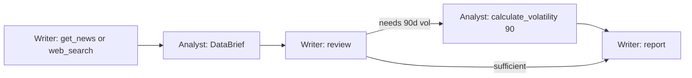
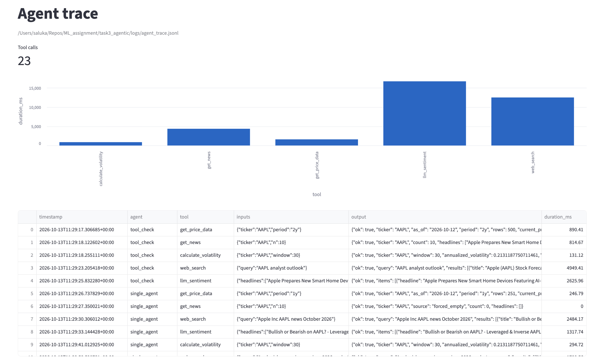

# Task 3 — Multi-agent financial research (LangGraph)

Notebook: [`notebooks/research_agents.ipynb`](notebooks/research_agents.ipynb) (run locally with `GROQ_API_KEY`; outputs kept).

## Design
- **Tools** (`src/tools.py`): `get_price_data`, `get_news`, `calculate_volatility`, `llm_sentiment`, `web_search`. Each returns a dict with `ok`. Errors are returned rather than raised, and every call is appended to `logs/agent_trace.jsonl` (tool, inputs, output truncated to 200 chars, duration). Indicators are computed from scratch in `src/indicators.py`.
- **3A, single agent:** LangGraph ReAct agent with all five tools. It chooses the tool order itself. The notebook forces one empty `get_news` result, so the trace shows the agent observing it and switching to `web_search`.
- **3B, two agents** (`src/graph.py`):
  - Agent A, the data analyst, may use only `get_price_data`, `calculate_volatility`, and `llm_sentiment`.
  - Agent B, the research writer, may use only `get_news` and `web_search`.
  - Every call goes through `_use()`, which raises `PermissionError` for a tool outside the caller's list.
  - A hands B a Pydantic `DataBrief`. B sends a `ClarificationRequest` for 90-session volatility, A replies with a `ClarificationResponse`, and B writes a validated `ResearchReport`.
- **3C, memory:**
  - Short-term: an `InMemorySaver` checkpointer keeps the agent's conversation. The follow-up question is answered with zero new tool calls, and the notebook prints the trace-line count before and after.
  - Persistent: `memory/<TICKER>_<date>.json`. A second run loads it and makes no tool calls.



## Run
```bash
python -m task3_agentic.src.pipeline --ticker AAPL --ignore-cache   # full run
python -m task3_agentic.src.pipeline --ticker AAPL                  # cache hit
python -m task3_agentic.src.pipeline --ticker AAPL --mode single    # ReAct agent
streamlit run task3_agentic/app/dashboard.py                        # trace dashboard (bonus)
```


